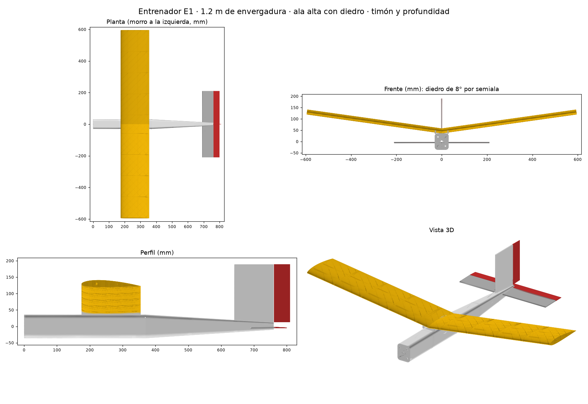
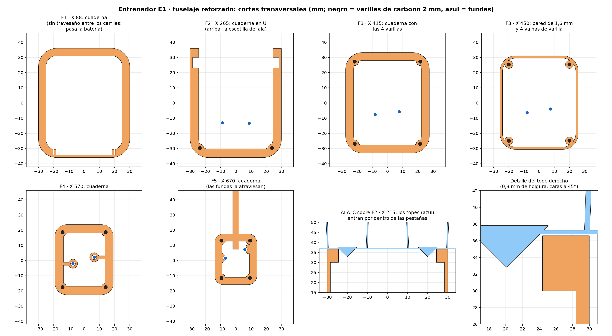
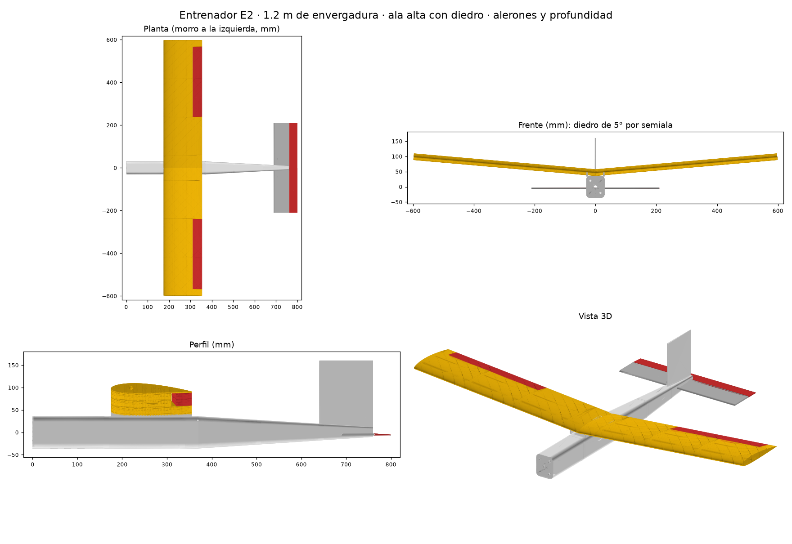
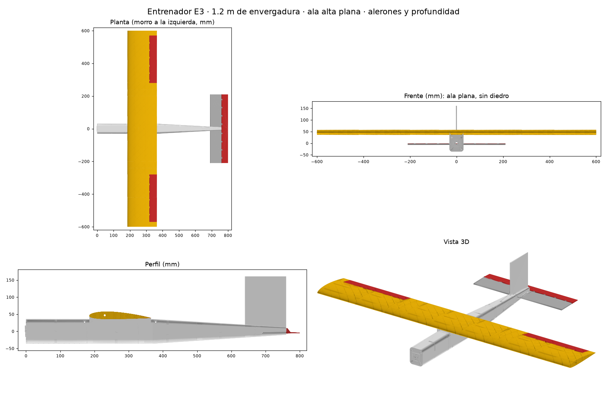
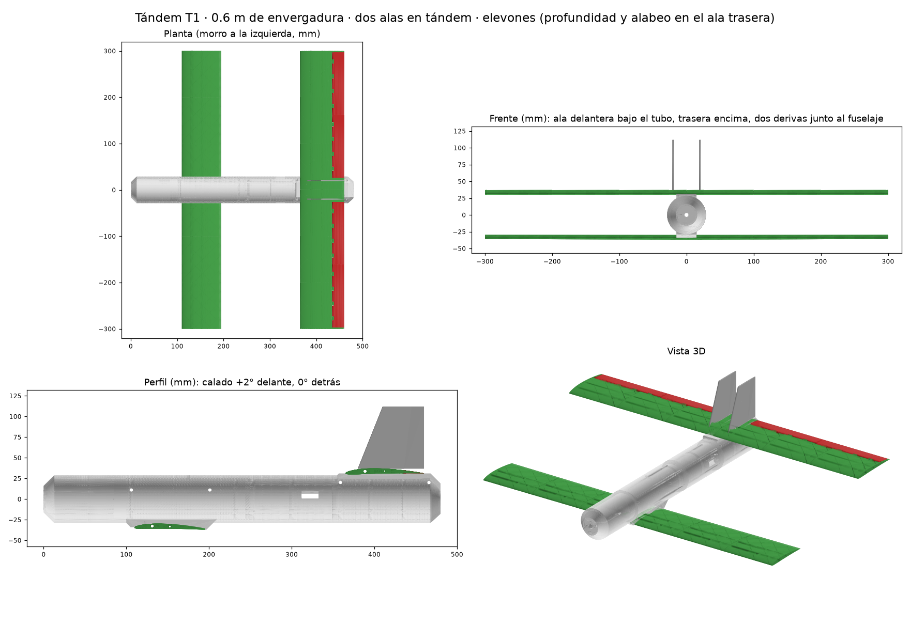

# Entrenador Vuelo RC

Simulador de vuelo RC para el aula (**Entrenador Vuelo RC**, `simulador/simulador.html`) y los dos aviones de aprendizaje impresos en 3D con los que se entrena, el **Entrenador E1** y el **Entrenador E2**. Repositorio: <https://github.com/AlvarLegaz/entrenador-vuelo-rc>.

Avión de aprendizaje impreso en 3D y simulador de vuelo para entrenar con él en clase. El **Entrenador E1** es un ala alta con poliedro (centro plano y 12° de diedro en las puntas) y solo dos servos, timón y profundidad: el diedro hace que nivele las alas solo cuando se sueltan los mandos. El **Entrenador E2** (más abajo) es la variante con alerones y profundidad, para que los alumnos practiquen también con alerones, y el **Entrenador E3**, el E2 con el ala plana.



## Datos del E1

| | |
|---|---|
| Envergadura y cuerda | 1200 × 180 mm, rectangular, NACA 2412 (`NACA2412.dat`) |
| Superficie alar | 21,6 dm² |
| Ala | **Poliedro:** plana hasta 300 mm del centro, con un tubo de carbono recto que la atraviesa; las puntas suben 12° desde ese quiebro |
| Masa en vuelo | 895 g (LW-PLA; F1 en PLA normal) |
| Carga alar | 41,4 g/dm² |
| Pérdida / crucero | 7,8 m/s / ≈ 9,5 m/s con la profundidad neutra (calado del estabilizador −1,2°) |
| Motor | SunnySky X2212 KV980, APC 9×4,7, ESC 30 A, 3S 1300 mAh. **Inclinado 2° hacia abajo** (downthrust) con la cuña impresa `CUNA_MOTOR` entre la cruz del motor y la bancada vertical de F1 |
| Centro de gravedad | 248 mm desde la bancada del motor = **63 mm detrás del borde de ataque del ala** (35 % de la cuerda). Margen estático 18 %. El ala va en X 185: con el fuselaje reforzado (pared de 1,6 mm, 4 larguerillos y cuadernas) la cola pesa bastante más, y con el ala en 175 el CG no bajaba del 38 %, donde el simulador entra en pérdidas cada vez más fuertes al cortar gas subiendo |
| Batería | Centrada a unos 56 mm de la bancada, cerca del fondo del morro, entre los dos carriles del suelo de F1 y sujeta con una cinta de velcro de 20 mm que pasa por las ranuras del suelo; el ESC va detrás de ella, en el mismo canal |

Todas las cifras salen de los scripts. Las masas se calculan sobre las mallas de las piezas y el VLM usa la geometría real. La pérdida, la resistencia parásita y el empuje en vuelo son estimaciones hasta calibrarlas con planeos del avión real.

**Motor inclinado y gas.** La línea de empuje pasa 22 mm por debajo del centro de gravedad y la hélice está 259 mm por delante, así que con motor el avión tiende a encabritar. Anularlo del todo pediría unos 5°. Se ha dejado en 2° (la cuña `CUNA_MOTOR`): compensa menos de la mitad del momento del motor y queda una tendencia clara a subir al dar gas, que en un entrenador es lo que se busca: el gas controla la altura. Si se quiere más o menos, basta con reimprimir la cuña con otro ángulo (`DOWNTHRUST` en `parametros_e1.py`) y regenerar. En el simulador, desde un planeo compensado a 9,5 m/s y sin tocar la profundidad, el 60 % de gas da una subida suave de unos 10° de cabeceo. El 100 % sube muy empinado, porque sobra motor (empuje máximo 1,07 veces el peso): se vuela con 50–70 % de gas y el 100 % se deja para el lanzamiento y las subidas.

**Por qué poliedro y no una V en la raíz.** Cada semiala hace palanca en el centro del ala: unos 3,8 N·m a 4 g (lanzamiento fuerte, recogida, ráfaga). Con la V en la raíz, los dos tubos de carbono terminaban en la pieza central y esa palanca la tenía que pasar la pieza impresa. Con el poliedro, el centro lleva un solo tubo recto y el quiebro está donde la palanca es 5 veces menor (0,8 N·m a 4 g). Allí la pasa una llave de tubo de aluminio de 6×4 mm doblada al ángulo del diedro, que aguanta unos 4,2 N·m. Para que el avión se comporte igual que con la V de 8° hacen falta 12° en las puntas: el VLM da el mismo efecto diedro (Cl_β −0,146 frente a −0,138) y la espiral se corrige a la mitad en unos 10 s.

## Piezas del E1 (carpeta `stl/E1/`)

Todas se imprimen sin soportes. Las medidas son las de la orientación de impresión del STL.

| Pieza | Cuántas | Cómo se imprime |
|---|---|---|
| `ALA_C` | 1 | Centro del ala, plano, de −75 a +75 mm, con los **topes** del intradós (ver montaje). De pie |
| `ALA_I_x2` | 2 | Tramo interior de 185 mm (de 75 a 260 mm), de pie. Igual para los dos lados |
| `ALA_Q_izq` | 2 | Pieza del quiebro (de 260 a 340 mm), con el ángulo de 12° y el nervio donde hacen tope los tubos. De pie sobre la cara del lado del centro; **la segunda, en espejo** |
| `ALA_E_x4` | 4 | Tramos exteriores de 130 mm, de pie. Todos iguales |
| `F1` | 1 | Morro con la bancada vertical, los carriles y las ranuras de la batería en el suelo y el agujero del palillo delantero. **PLA normal**, de pie sobre la bancada |
| `CUNA_MOTOR` | 1 | Cuña de 34 × 34 mm (2 → 3,2 mm) que da los 2° de downthrust. **PLA normal**, tumbada sobre su cara plana |
| `F2`–`F5` | 1 de cada | Fuselaje, de pie sobre la cara delantera. El cuello de unión queda arriba. F2 lleva la bandeja de los servos; F3 a F5, las guías de las transmisiones; F5, la deriva con los nudillos de la bisagra del timón |

**Fuselaje reforzado.** Pared de **1,6 mm** (4 líneas de 0,4; con 1 mm salía flojo), **vainas de varilla de carbono en las 4 esquinas** y una **cuaderna a mitad de cada tramo**: un marco de 5 mm de ancho y 2,5 de grueso pegado por dentro a la pared, que ata las cuatro paredes y abraza las vainas (en la cola, más estrecho). Tiene la cara de abajo a 45°, así que se imprime de pie sin soportes. La de F1 no tiene travesaño entre los carriles, para que pase la batería; la de F2 es una U abierta por arriba, porque el techo bajo el ala es la escotilla; las fundas de las transmisiones atraviesan las de F4 y F5 y les sirven de guía. Los cortes están en `E1_fuselaje_secciones.png`.


| `ESTAB_izq`, `ESTAB_der` | 1 de cada | Estabilizador con los nudillos de la bisagra y el solape a media madera del centro (20 mm: la izquierda lleva la media placa de arriba y la derecha la de abajo). Tumbados |
| `PROF_izq` | 1 | Mitad izquierda de la profundidad, con el horn impreso. Tumbada |
| `PROF_der` | 1 | Mitad derecha de la profundidad. Tumbada |
| `TIMON` | 1 | De pie sobre su canto de abajo, con el horn apoyado en la cama (ponle borde de adherencia) |

Las piezas de ala son cuerpos de pared única con celosía interior. Estabilizador, profundidad y timón van con 2 perímetros, 3 capas arriba y abajo y 10 % de relleno.

**Compras:**
- Tubo de carbono 8×6 mm: 1 de 600 mm (centro) y 2 de 300 mm (puntas).
- Varilla de carbono de 3 mm: 2 de 600 mm (largueros traseros).
- **Varilla de carbono maciza de 4 mm:** 2 trozos de 80 mm, para los palillos de las gomas.
- **Tubo de aluminio de 6×4 mm:** 2 trozos de 100 mm, para las llaves del quiebro. Si no entra en el tubo de carbono, lija un poco.
- Varilla de carbono de 2 mm, unos 80 cm: 2 de 100 mm para unir el estabilizador, 1 de 420 mm de pasador de la profundidad y 1 de 180 mm de pasador del timón.
- **Larguerillos del fuselaje:** varilla de carbono de 2 mm, 6 trozos: abajo, 2 de 154 mm (parte recta, X 215–369) y 2 de 314 mm (parte que se estrecha, X 371–685); arriba, 2 de 296 mm (X 389–685). Unos 7,5 g.
- 2 transmisiones tipo Bowden de 550 mm (funda de 2–3 mm y alambre de 0,8 mm), 2 servos de 9 g y gomas.

**Montaje:**
1. **Fuselaje.** Pega F1 a F5 por sus cuellos (entran 15 mm en el tramo siguiente). Lija el cuello, usa epoxi de 5 min (rellena la holgura mejor que el cianocrilato) y limpia el sobrante. Después da **una vuelta de cinta de fibra de vidrio o kevlar de 20 mm alrededor de cada unión**, pegada con el mismo epoxi: el pegamento del cuello sobra, pero los tramos se imprimen de pie y la pared junto al escalón del cuello es por donde rompería el LW-PLA en un golpe; la cinta lo evita por 2-3 g. Las uniones que más lo agradecen son F1|F2 (el morro, PLA contra LW-PLA) y F2|F3 (bajo el ala, donde el cuello no tiene techo). **Larguerillos:** con los tramos ya pegados y antes de poner los palillos, mete las seis varillas de carbono de 2 mm desde dentro, por la escotilla del ala. Abajo van dos por lado: la de 154 mm en la parte recta y la de 314 mm en la que se estrecha, empujándola hasta F5. Arriba, la de 296 mm de cada lado, que empieza detrás del palillo trasero (X 389): entra en ángulo por la escotilla y se dobla un poco para meterla en su vaina. Fíjalas con unas gotas de cianocrilato fluido en cada extremo y en cada unión. Llevan la tracción en un golpe: el fuselaje se imprime de pie y, al flexionarse, intenta despegar capa de capa, que es como peor aguanta una pieza impresa; con las varillas, para partirlo hay que romper el carbono.
2. **Llaves del quiebro.** Dobla cada tubo de aluminio 12° por el centro, en un tornillo de banco o sobre el canto de una mesa.
3. **Centro del ala.** Mete el tubo de 600 mm por `ALA_C` y los dos `ALA_I`, y una pieza `ALA_Q` en cada extremo, hasta que el tubo haga tope en su nervio. Debajo de `ALA_C` hay cuatro **topes** en cuña, dos por lado (de X 205 a 245 y de 290 a 330), que entran justo por dentro de las pestañas del asiento del fuselaje con 0,3 mm de holgura: el ala no se desliza de lado y, al apoyarla, se centra sola.
4. **Puntas.** Mete la llave de aluminio por el agujero del nervio de `ALA_Q`, 50 mm dentro de cada tubo, y pégala con epoxi. Desliza el tubo de punta de 300 mm sobre la otra mitad de la llave, hasta el nervio. Después monta los dos `ALA_E` de cada lado.
5. **Varillas de 3 mm.** Van partidas en el quiebro: cada trozo hace tope en el nervio de `ALA_Q`.
6. **Pegado del ala.** Pega todos los tramos entre sí por sus caras, del centro hacia las puntas, sobre una mesa plana. Comprueba con una regla que el borde de fuga queda recto.
7. **Estabilizador.** Pasa las dos mitades por la ranura de F5, cada una desde su lado: en el centro encajan por el solape a media madera (la izquierda por encima de la derecha) y las dos varillas de 100 mm atraviesan el solape. Alinéalo con el ala (visto desde atrás y desde arriba) y pega el solape, las varillas y la ranura.
8. **Profundidad.** Pega las dos mitades a tope por el centro. Mete el pasador de 420 mm por los nudillos del estabilizador y el canto de la profundidad, y pégalo **solo a la profundidad**: debe girar libre en los nudillos del estabilizador.
9. **Timón.** Igual, con el pasador vertical de 180 mm: pegado al timón y libre en los nudillos de la deriva.
10. **Servos.** Van de pie en la bandeja de F2, atornillados por sus orejetas: el de la profundidad delante y el del timón detrás.
11. **Motor.** La cruz del X2212 se atornilla a la bancada de F1 con 4 tornillos M3 × 14 y tuercas por dentro (cruz 1,5 + cuña 2-3,2 + placa 4 + tuerca 2,4 mm), con la cuña `CUNA_MOTOR` entre medias (la parte gruesa arriba: así el eje apunta 2° hacia abajo). Los agujeros de la cuña son perpendiculares a su cara inclinada; los de F1, a la placa.
12. **Batería y ESC.** Van en el canal entre los dos carriles del suelo de F1 (37 mm de ancho, de X 8 a 160). La batería se coloca donde diga la tabla de datos de su avión (E1: a unos 56 mm; E2, con el fuselaje de 5 mm: a unos 60 mm; E3, por su deriva más alta: a unos 45 mm, justo al principio de los carriles; en los dos con el ESC detrás de ella porque delante no cabe) y se sujeta con una **cinta de velcro de 20 mm** que pasa por dos de las ranuras del suelo (hay una cada 15 mm) y la rodea; el ESC va en el mismo canal (delante de la batería en E2/E3, detrás en E1) sujeto igual o con velcro adhesivo, y las ranuras bajo él hacen de rejilla de ventilación.
11. **Transmisiones.** Las fundas pasan por los anillos guía de F3 a F5:
    - **Profundidad:** sale por el costado izquierdo de F5, por encima del estabilizador, y va al horn de encima de la profundidad.
    - **Timón:** sale por el lomo, a la derecha de la deriva, y va al horn del timón.
    - El horn tiene 3 agujeros para el doblez en Z del alambre: el de abajo da más recorrido.
12. **Ala al fuselaje.** Se sujeta con 4–6 gomas sobre los dos palillos de carbono. Quitando el ala queda abierta la escotilla.
13. **Prueba de los palillos.** Con el ala puesta, tira hacia arriba de un extremo de un palillo con una báscula de equipaje hasta unos 3 kg. No debe crujir nada.

## Regenerar el diseño

Todos los números del diseño están en `scripts/parametros_e1.py`. Después de cambiarlos, ejecuta en orden:

```
python scripts/geom_e1.py          # piezas (scripts/out/stl) y mallas montadas
python scripts/masas_e1.py         # masa, CG, posicion de la bateria, inercias
python analisis/vlm_e1.py 0.895 0.0361 0.0746   # estabilidad y calado del estabilizador (masa, Ixx, Izz)
python scripts/modelo_aero_e1.py   # modelo de vuelo -> simulador/aviones/E1.js
python scripts/vistas_e1.py        # ENTRENADOR_E1_vistas.png
```

## Entrenador E2: alerones y profundidad

La misma célula que el E1 (fuselaje, cola horizontal, motor y batería) con **alerones y profundidad** (2 canales) y la **deriva fija, sin timón**. Sus números están en `scripts/parametros_e2.py`, que solo redefine lo que cambia respecto a `parametros_e1.py`.



| | |
|---|---|
| Ala | Poliedro: plana hasta 240 mm del centro y **7° de diedro** en las puntas. El quiebro va justo antes del alerón, que queda entero en el panel exterior |
| Alerones | 25 % de la cuerda, de 280 a 570 mm del plano de simetría. **Bisagra de nudillos** con pasador de carbono de 2 mm, que también une los dos tramos de cada alerón. Recorrido mecánico ±15° (comprobado: a ±20° no tocan el ala); en el simulador ±5°, porque con teclado la palanca va siempre a tope |
| Servos | 3 de 9 g: profundidad en la bandeja de F2 y uno por alerón dentro del ala (cajeado abierto por el intradós en el centro de `ALA_E1`) |
| Deriva | Fija, 120 × 145 mm (la parte fija de F5 con el borde de fuga afinado) |
| Masa en vuelo | 1.227 g con el fuselaje de 5 mm (903 g con el de 1,6); carga alar 56,8 g/dm² (41,8) |
| Centro de gravedad | 244 mm desde la bancada (33 % de la cuerda). Margen estático 18 % |
| Batería | Centrada a unos 60 mm de la bancada con el fuselaje de 5 mm (94 mm con el de 1,6), entre los carriles del suelo de F1 y con cinta de velcro por las ranuras; el ESC va detrás de ella (con el fuselaje de 1,6, delante), en el mismo canal, sobre las ranuras que lo ventilan |
| Calado del estabilizador | −0,9° (vuela a ≈ 11 m/s con la profundidad neutra; a 9,5 con el fuselaje de 1,6 mm) |

**Por qué 7°.** Con poliedro a 240 mm el VLM da: con 6° la espiral se duplica en ~40 s, con 7° se corrige a la mitad en ~90 s (casi neutra, como debe ser un avión de alerones: no vuelve solo al nivel, pero tampoco se cierra en espiral) y con 8° en ~20 s. La guiñada adversa de los alerones es pequeña (Cn_δa / Cl_δa ≈ −0,03). La V de 2,5° en la raíz que tenía antes se cerraba en espiral (doblaba en ~8 s).

**Banco de pruebas del simulador** (física sola, sin viento; con el fuselaje de 1,6 mm. Con el de 5 mm hace falta un 80 % de gas o más para lanzarlo y planea compensado a unos 11 m/s): lanzado al 75 % de gas sin tocar los mandos sube a 1,6 m/s; planea a 9,9 m/s con 1,1 m/s de descenso; inclinado 30° y soltando los mandos sigue a 12° a los 25 s; un segundo de alerón lo deja a ~21° y se mantiene inclinado.

**Piezas (carpeta `stl/E2/`).** `F1`, `F4`, `ESTAB_izq`/`ESTAB_der` y `PROF_izq`/`PROF_der` son idénticas a las del E1; `F2` (bandeja con un solo servo útil), `F3` y `F5` (deriva fija, solo la salida de la profundidad) cambian. No hay `TIMON`.

| Pieza | Cuántas | Cómo se imprime |
|---|---|---|
| `ALA_C` | 1 | Centro plano, de −75 a +75 mm |
| `ALA_I_x2` | 2 | Tramo interior de 125 mm (de 75 a 200 mm). Igual para los dos lados |
| `ALA_Q_izq` | 2 | Quiebro de 7° (de 200 a 280 mm). **La segunda, en espejo** |
| `ALA_E1_x2` | 2 | Tramo de 140 mm (de 280 a 420) con el corte del alerón, sus nudillos y el cajeado del servo en el centro. Igual para los dos lados |
| `ALA_E2_izq` | 2 | Tramo de punta (de 420 a 600) con el corte del alerón hasta 570. **La segunda, en espejo** |
| `ALERON_A_x2` | 2 | Alerón de 140 mm con la ranura del horn, de pie |
| `ALERON_B_x2` | 2 | Alerón de 150 mm, de pie |

**Compras respecto al E1:**
- 3 servos de 9 g en vez de 2.
- Una sola transmisión Bowden.
- 2 alargadores de cable de servo de 300 mm y un cable en Y: los dos servos de alerón llegan por dentro del ala a la boca de `ALA_C` y se unen en la escotilla; el Y va al receptor, así que al quitar o poner el ala solo hay un conector.
- 2 varillas de empuje cortas con sus horns para los alerones.
- Varilla de carbono de 2 mm: 2 pasadores de 290 mm para los alerones, en vez del pasador del timón.
- Tubo central de 480 mm y 2 tubos de punta de 360 mm, en vez de 600 + 2 × 300 (el quiebro está a 240 mm).

**Montaje (lo que cambia):**
1. **Llaves:** se doblan 7°.
2. **Servos de los alerones:** entran de costado por el intradós de `ALA_E1`, con el brazo hacia abajo y el eje hacia el alerón (varilla corta y recta). El cable va **por dentro del ala**: por la abertura del cajeado entra en el canal de 8 mm (a 69 mm del borde de ataque, entre el tubo y el larguero trasero) que recorre `ALA_E1`, `ALA_Q` (por su nervio), `ALA_I` y `ALA_C`, y sale por la boca del intradós de `ALA_C`, encima de la escotilla. Se enhebra al montar: pasa el cable (o un hilo guía) por cada tramo antes de pegarlo al siguiente.
3. **Alerones:** cada uno se monta con sus dos tramos sobre el pasador de 2 mm, que entra por los nudillos del ala y se pega solo al alerón.
4. **F5:** solo se usa la salida de la profundidad.

**Fuselaje con pared de 5 mm (E2 y E3).** Como en el E3 (ver su sección): `PARED_FUS = 5.0` en `parametros_e2.py`, F1–F5 y `ALA_C` cambian, sin larguerillos ni cuadernas. 1.227 g, pérdida 9,1 m/s, empuje/peso 0,68.

**Regenerar el E2:** los mismos scripts, con la variable de entorno `ENTRENADOR=E2` (escriben en `scripts/out_E2/` y en `simulador/aviones/E2.js`):

```
$env:ENTRENADOR = "E2"             # PowerShell (en cmd: set ENTRENADOR=E2)
python scripts/geom_e1.py          # piezas (scripts/out_E2/stl) y mallas montadas
python scripts/masas_e1.py
python analisis/vlm_e1.py 1.227 0.0400 0.0868       # con el fuselaje de 5 mm
python scripts/modelo_aero_e1.py   # -> simulador/aviones/E2.js, con la clase ModeloE2 de scripts/clase_e2.js
python scripts/vistas_e1.py        # ENTRENADOR_E2_vistas.png
```

## Entrenador E3: alerones y profundidad, ala plana

El E2 con el ala **totalmente plana, sin diedro**, y una **deriva más alta** (120 × 195 mm en vez de 120 × 145). Es el paso siguiente para quien ya vuela con alerones: sin diedro el avión no tiende a nivelar las alas y hay que llevarlo siempre con los alerones. Sus números están en `scripts/parametros_e3.py` (cambian el diedro y la altura de la deriva respecto al E2).



**Cómo vuela (VLM y simulador).** Con el ala plana la espiral es inestable: si se inclina el avión y se sueltan los mandos, la inclinación se duplica en unos 4 s según el modelo lineal. En el banco de pruebas del simulador, 10° de inclinación con las manos quietas pasan a 40° en 20 s, mientras el avión baja ganando velocidad. Es lo normal en un avión sin diedro; el E2, con 7°, es casi neutro. El resto (lanzamiento, planeo, pérdida, margen estático 18 %) es igual que en el E2.

**Por qué la deriva más alta.** Con la deriva del E2 (120 × 145, pequeña a propósito porque allí, con 7° de diedro, más deriva abre la espiral) el E3 tenía muy poca estabilidad de veleta (Cn_β 0,045, Cn_r −0,049; el Poli-1 tiene 0,104 y −0,19) y daba bandazos: un segundo de alerón a tope le hacía resbalar 22° y luego oscilaba ±9°. En el E3 la espiral la manda el ala plana y no la deriva (con cualquier deriva del barrido dobla en unos 4 s; para que tardase 20 s haría falta diedro), así que la deriva se dimensiona solo para el balanceo holandés. Barrido con `vlm_e1.py` (α 3°, 9,5 m/s):

| Deriva (cuerda × alto, mm) | Cn_β | Cn_r | Cl_β | Holandés (Hz / amortiguamiento) | F5 impreso |
|---|---|---|---|---|---|
| 120 × 145 (la del E2) | 0,045 | −0,049 | −0,019 | 0,47 / 0,156 | 179 mm |
| 120 × 185 | 0,075 | −0,073 | −0,027 | 0,59 / 0,161 | 219 mm |
| **120 × 195 (elegida)** | **0,083** | **−0,079** | **−0,030** | **0,62 / 0,163** | **229 mm** |
| 150 × 185 | 0,082 | −0,083 | −0,028 | 0,62 / 0,170 | 218 mm |
| 170 × 185 | 0,086 | −0,090 | −0,028 | 0,63 / 0,176 | 217 mm |

Las cuerdas de más de 120 mm sobresalen por detrás del fuselaje y ganan poco a cambio de 5–8 g más en la cola, que con la batería ya casi en la bancada obligarían a poner plomo en el morro. Con 120 × 195 toda la deriva sigue en `F5` (que sale de 229 mm, como `ESTAB`), pesa 3,5 g más, y el holandés se apaga antes: en el simulador, tras una racha de 10° de resbale con los mandos sueltos, el resbale baja de 1° en 2,9 s (antes 4,0 s), y el segundo de alerón a tope deja el resbale máximo en 13° (antes 22°) y la oscilación siguiente en ±3° (antes ±9°). El amortiguamiento por ciclo apenas cambia (0,16): la mejora está en la estabilidad de veleta y en lo rápido que oscila y se calma.

**Piezas (carpeta `stl/E3/`).** Todas son idénticas a las del E2 salvo `ALA_Q_izq`, que sale recta (sin ángulo en el quiebro), y `F5`, con la deriva de 195 mm de alto (la pieza mide 229 × 31 × 120 mm de pie, como siempre sobre su cara delantera). La llave de aluminio del quiebro va **sin doblar**. El resto del montaje y las compras, como el E2.

**Fuselaje con pared de 5 mm (E3).** `F1`–`F5` llevan pared de 5 mm en vez de 1,6 (`PARED_FUS` en `parametros_e3.py`), engordada hacia dentro: la forma exterior y los encajes no cambian, y `ALA_C` lleva los topes más adentro para las pestañas del asiento. Sin larguerillos de carbono ni cuadernas (sobran y en la cola no caben); las fundas de las transmisiones pasan por túneles en la pared de la cola. Interior: 50 × 62 mm delante, 8 × 12 mm al final. Pesa bastante más: fuselaje 596 g (antes 264), avión 1.230 g con la deriva alta (antes 903), carga alar 56,9 g/dm² (antes 41,8), así que la pérdida sube un 17 % (de 7,8 a unos 9,1 m/s). Con el CG al 33 % la batería va adelantada, centrada en X 45 mm (de X 9 a 81: justo al principio de los carriles; con la deriva del E2 iba en X 60). El simulador ya vuela este E3 de 1.230 g. Con el calado del estabilizador de siempre (−0,9°) compensa a unos 11 m/s en vez de 9,5, con el mismo margen sobre la pérdida; el empuje/peso baja de 0,93 a 0,68 y para lanzarlo a mano hace falta un 80 % de gas o más (comprobado en el simulador).

**Regenerar el E3:** los mismos scripts con `ENTRENADOR=E3` (escriben en `scripts/out_E3/` y en `simulador/aviones/E3.js`; el VLM con `python analisis/vlm_e1.py 1.230 0.0400 0.0884` (con el fuselaje de 5 mm y la deriva alta)). Después, `python simulador_godot/pruebas/generar_referencia_fisica.py` regenera las trazas de la prueba de Godot.

## Tándem T1: dos alas en tándem, elevones, PLA normal

Avión aparte de los entrenadores: dos alas de 600 mm en tándem (la delantera baja, con calado +2° y torsión −1,5° en la punta; la trasera alta, con los elevones y dos derivas sobre ella, junto al fuselaje), fuselaje tubular de 57,6 mm (pared de 5 mm; antes 50 mm con 1,2) en cuatro tramos y sin cola. El diseño y sus STL están en `stl/T1/` (`stl/T1/scripts/geom.py` genera las piezas; `stl/T1/ALFA-T_planos.pdf`, los planos del diseño original). Se calcula **todo impreso en PLA normal** y con **el motor y la batería del E1** (X2212 KV980, APC 9×4,7, ESC 30 A, 3S 1300), que es como se quiere construir. Los números que no están en la geometría (material, componentes, CG, mandos) están en `scripts/parametros_t1.py`.



| | |
|---|---|
| Alas | 2 × 600 × 85 mm (delantera) y 600 × 95 mm (trasera), NACA 3407, 10,8 dm² en total. Sin diedro |
| Derivas | Dos placas de 80 × 75 mm (`WINGLET_x2`) sobre el ala trasera, a ±20 mm del centro, con el borde de fuga en el final del fuselaje |
| Masa en vuelo | **1.088 g** con el tubo de pared de 5 mm (fuselaje 588 g impresos y 37 g de lastre en el morro). Con la pared de 1,2 mm: 680 g (fuselaje 220). El diseño original, en LW-PLA y con motor 1404 y 2S 450, pesaba 247 g |
| Carga alar | 101 g/dm² con la pared de 5 mm (63 con la de 1,2; el E1: 41) |
| Centro de gravedad | X 221 mm desde la placa del motor. Punto neutro (VLM) X 235 (el plano original decía 234): margen estático 15 % de la cuerda media (90 mm) |
| Batería | Sobre el suelo de F2, centrada en X 146 (de X 110 a 182). Con el motor de 57 g en el morro y la cola en PLA, el ESC va al suelo de F3 (delante de los servos) y el receptor al de F4 |
| Pérdida | **12,0 m/s**: entra el ala delantera (más calada y sin el downwash de la otra). La trasera entra a 14° de fuselaje. La pérdida "del conjunto" con CLmax 1 serían 10 m/s, pero el ala delantera llega a su CLmax mucho antes |
| Crucero | ≈ 13 m/s con −2,3° de elevón (compensador por defecto del simulador). Vuelo nivelado con el 65–70 % de gas |
| Elevones | 2 por lado, 25 % de la cuerda, de 26 a 297 mm, en una sola pieza `ELEVON_x4`. Recorrido mecánico ±15° (comprobado a ±20° sin tocar el ala); en el simulador 10° de profundidad y 2,5° de alabeo (Ixx 0,0057 kg·m² y sin derivas en las puntas que frenen el alabeo: con 4°, un segundo de palanca lo ponía a 120°; con 2,5°, a unos 70°) |

**Mejoras de los entrenadores aplicadas al T1** (`geom.py`, revisión 2026-10-11; las STL de `stl/T1/stl/` son las regeneradas):
- **Pared del tubo de 5 mm** (`WALL` en `geom.py`; petición del usuario, como los entrenadores E2/E3). Crece hacia fuera: el tubo pasa de Ø50 a Ø57,6 y el interior sigue en Ø47,6, así que la batería 3S 1300, los suelos, los servos, el cuello, las chavetas y las bridas no cambian; el morro y la cola se derivan del radio y las dos alas se separan 3,8 mm más del eje. Antes era de 1,2 mm (3 líneas de 0,4).
- **Cuello F1|F2 de 15 mm** (antes 10), con los radios del cuello y de las chavetas derivados de la pared.
- **Bancada para el X2212**: cruz de 16 × 19 mm, M3 con tuerca por dentro, paso del eje de 9 mm. Sin cuña de downthrust: el eje del motor pasa por el centro de gravedad (Z +2 mm), no hay momento que compensar.
- **Bisagras de nudillos** en los elevones, como los alerones del E2 pero a la escala de un perfil de 3,5 mm: eje en la línea de bisagra sobre la línea media, nudillos de radio 2,1 y 8 mm de largo (cuatro por elevón, a ±16 y ±48 mm de su centro: simétricos, así la misma pieza vale para los dos lados y los nudillos no cruzan las juntas de los tramos del ala), pasador de carbono de 2 mm pegado al elevón y libre en el ala, que además une los dos elevones de cada lado. El canto delantero del elevón es un redondo de Ø4,2 alrededor del pasador, con 0,6 mm de holgura a la pared de cierre del ala. Los nudillos asoman 0,4 mm por encima y por debajo del perfil.
- **Palillos de las gomas de carbono macizo de 4 mm** (`DOWEL_D`); el delantero se adelanta 2 mm para no cortar el labio del cuello.
- **Suelos con ranuras para cinta de velcro de 20 mm**, a Z −12: en F2 para la batería (X 108–222, ranuras en X 130, 160, 190 y 215), en F3 para el ESC (X 262–290) y en F4 para el receptor (X 365–395). Los anillos de refuerzo de F2 se mueven a X 106 y 232 para dejar libre la zona de la batería (sus esquinas tocaban el anillo que había en X 150, y a Z −10 tocaban las vainas de los larguerillos de arriba). Los suelos de F1 (batería 2S y ESC del diseño original) se mantienen, acortados por el cuello.
- No se aplica el **poliedro/diedro** (el tándem va con las alas planas por decisión de diseño) ni el canal de cables dentro del ala (los servos van en el fuselaje).

Comprobado al regenerar: 0 interferencias ala-fuselaje y entre tramos; los elevones giran ±20° sin tocar el ala; la batería 3S 1300 (72 × 35 × 24), el ESC (45 × 24 × 8) y el receptor (36 × 21 × 12) caben sobre sus suelos sin tocar nada (la batería en cualquier sitio entre X 110 y 222).

**Con la pared de 5 mm (simulador actual): no se puede lanzar a mano.** El tubo grueso pesa 368 g más y casi todo detrás del CG: la batería va lo más adelante que deja su suelo (centrada en X 144) y aun así hacen falta **37 g de lastre** sobre el suelo de F1 (X 30) para el CG en X 221 (margen estático 16,5 %; `masas_t1.py` lo calcula solo). Con 1.088 g la pérdida sube a **15,1 m/s** (antes 12), compensa a unos 15 m/s y el empuje/peso baja de 1,24 a 0,77: a tope sube solo 1,5 m/s. En el simulador, lanzado a mano (10 m/s) **cae con cualquier gas**, en real y en fácil. Para volarlo haría falta un lanzador (goma o carro) por encima de 15 m/s o más ala. Lo de abajo es el T1 de 680 g.

**Cómo vuela (VLM y banco de pruebas del simulador, sin viento; T1 de 680 g, pared de 1,2 mm).** Reparto de sustentación muy desigual: a 12 m/s el ala delantera va a CL 0,9 y la trasera a 0,45, por eso la pérdida la fija la delantera y, al entrar, el morro cae solo (la tabla CL/Cm del modelo lleva la pérdida progresiva de cada ala, `scripts/modelo_aero_t1.py`). Sin motor planea a 13–14 m/s bajando unos 2,3 m/s (L/D ≈ 6, con la hélice de 9" parada, que suma 0,025 de CD). Las derivas son imprescindibles: sin ellas Cn_β es negativo (inestable en guiñada); con ellas Cn_β 0,033. Junto al fuselaje no dan efecto diedro (Cl_β −0,006, frente a −0,08 si estuvieran en las puntas), así que **la espiral es inestable: inclinado y con las manos quietas, la inclinación se duplica cada 3 s** según el modelo lineal (en el banco del simulador, de 30° pasa a 43° en 12 s mientras acelera a 18 m/s); hay que llevarlo siempre con los elevones. Balanceo holandés a 0,5 Hz, amortiguamiento 0,13. Tirando a tope sin motor no se desploma: se queda a 14° de ataque bajando 10 m/s a 15 m/s, y recupera solo al soltar.

**Lo que sigue pendiente para construirlo** (lo dice el análisis, no el simulador):
- La hélice de 9" (Ø229 mm) baja 90 mm por debajo del ala delantera: solo se puede aterrizar con el motor parado y, aun así, toca. La de 4" del diseño original ya sobresalía 26 mm.
- Los servos de 3,7 g del diseño se mantienen (los elevones son pequeños); las ventanas de F3 son para ese tamaño. El ESC se mete por el morro (F1 es desmontable) hasta su suelo en F3, a 26 cm; conviene pegarle el velcro antes.
- Con PLA normal, 680 g y 63 g/dm² vuela a 13–15 m/s: es un avión rápido, no un entrenador. El simulador lo muestra tal cual.

**Piezas (carpeta `stl/T1/stl/`).** `F1_morro_motor` (placa del motor en la cama), `F2_central_ala_del`, `F3_central` (brida trasera en la cama), `F4_cola_ala_tras` (tapa de cola en la cama), `AD1..AD3_izq/der` y `AT1..AT3_izq/der` (tramos de ala de 100 mm, de pie; los `AT` llevan los nudillos), `ELEVON_x4` (tumbado; la pieza es simétrica y vale para los dos lados), `WINGLET_x2` (tumbado). **Compras respecto al diseño original:** 4 varillas de carbono macizo de 4 mm × 60 (palillos), 2 pasadores de carbono de 2 mm × 271 (elevones), 4 tornillos M3 × 12 con tuerca (motor) y cinta de velcro de 20 mm.

**Regenerar el T1:**

```
$env:ENTRENADOR = "T1"
python stl/T1/scripts/geom.py      # piezas (stl/T1/scripts/out/stl) y mallas montadas; copiar a stl/T1/stl
python scripts/masas_t1.py         # masa, CG, posicion de la bateria, inercias (PLA, X2212, 3S 1300)
python analisis/vlm_t1.py          # punto neutro, equilibrio, reparto entre alas, derivadas, modos, derivas
python scripts/modelo_aero_t1.py   # modelo de vuelo -> simulador/aviones/T1.js (clase ModeloT1 de scripts/clase_t1.js)
python scripts/vistas_t1.py        # TANDEM_T1_vistas.png
```

El VLM es el mismo de los entrenadores (`analisis/vlm_e1.py`), que ahora admite la configuración tándem (dos alas, torsión, elevones que son profundidad y alerón a la vez, derivas fuera del plano de simetría) y devuelve las fuerzas por superficie; los resultados del E1, E2 y E3 no cambian.

## Simulador

`simulador/simulador.html` (Entrenador Vuelo RC). Funciona de tres formas, a elección del usuario:

- **Con el servidor del aula** (lo normal en clase, varios ordenadores). Se eligen alumnos, se guardan todos los vuelos en la base de datos común y el profesor tiene su panel.
- **Registro local**, abriendo `simulador.html` con doble clic y pulsando "Registro local en este ordenador". Alumnos, vuelos y progreso se guardan en el navegador de ese ordenador y, si se quiere, en un **archivo JSON** ("Guardar en un archivo…": en Chrome y Edge el archivo se reescribe solo tras cada vuelo; "Exportar copia" / "Importar copia" valen en cualquier navegador y para llevar el registro a otro ordenador). El progreso se calcula igual que en el servidor; no hay panel del profesor ni autorización de la maqueta real.
- **Volar sin registrar**: sin servidor y sin registro local. Se vuela igual, pero los vuelos no se guardan.

**Pantallas** (2026-10-12, interfaz tipo simulador): **Inicio** (el avión elegido en 3D sobre la ortofoto de Cartagena y el menú: Vuelo libre, Entrenamientos, Hangar, Ajustes; abajo, el piloto y el aula) → si hay aula y no hay piloto elegido, **Pilotos** → **Vuelo libre** (campo del club o Campo de Cartagena, con las condiciones de viento; en Cartagena, después el mapa para elegir el punto de lanzamiento) o **Entrenamientos** (tarjetas con icono, dificultad en estrellas y estado, y la ficha de la elegida con sus objetivos) → **pantalla de carga** en los mundos reales → vuelo → **Resultado** (veredicto, cifras del vuelo, traza en planta coloreada por altura y perfil de altura, objetivos, repetición y caja negra) → progreso. El **Hangar** tiene el avión girando, la ficha y, en «Ajustes del avión», plegados, el centro de gravedad y el peso, los recorridos de la emisora y la calibración. **Ajustes**: mando, teclado, calidad gráfica (automática o fija), sonido, dificultad y registro. Los escenarios con `enVuelo` (el aterrizaje guiado) empiezan con el avión volando; los demás, en la mano del piloto.

**En vuelo:** arriba a la izquierda el estado (en mano, volando, REC, motor parado, pausa); abajo en el centro las lecturas (velocidad del aire con los colores de la pérdida, altura sobre el terreno, ascenso, rumbo, distancia y batería); a la izquierda el GPS (cámaras 2 y 3), el gas y la palanca; a la derecha el variómetro, el anemómetro y el horizonte con la brújula. **Esc** abre el menú de pausa (continuar, empezar de nuevo, cámara, instrumentos, controles, terminar, salir). **Sonido** con Web Audio: motor según las revoluciones y el gas (desde la cámara del piloto se oye más lejano cuanto más se aleja el avión), viento según la velocidad, aviso de pérdida y el golpe de la toma o del accidente. **Repetición**: desde el resultado, el vuelo grabado en la caja negra (20 Hz) se reproduce con las mismas cámaras e instrumentos (espacio pausa, flechas ±5 s, Esc sale).

**Teclas:**

| Tecla | Qué hace |
|---|---|
| Flechas ↑ ↓ | Profundidad (↓ tira, morro arriba) |
| Flechas ← → | Timón (E1), alerones (E2 y E3) o elevones (T1) |
| W / S | Gases |
| Espacio | Cortar gases |
| L | Lanzar |
| R | Empezar de nuevo (sin guardar el vuelo) |
| Esc | Pausa (y desde ella terminar el vuelo o salir al menú); con la ventana de controles abierta, la cierra |
| H / I | Datos de vuelo en texto / instrumentos sí o no |
| 1 / 2 / 3 | Cámaras: piloto (con zoom automático: el campo de visión se cierra al alejarse el avión para que su envergadura ocupe siempre la misma parte de la pantalla, un 10 % por defecto, hasta un teleobjetivo de 1,5°; se elige en Ajustes › Gráficos, de «sin zoom» a un 22 %, y en vuelo con la rueda del ratón; igual en Godot), persecución y a bordo. En las cámaras 2 y 3 aparece abajo a la derecha un horizonte artificial (alabeo y cabeceo) con la rosa de rumbos en el anillo exterior, como el del simulador del submarino, y sobre la rosa tres marcas: amarilla, hacia el piloto (casa); magenta, el eje de la pista; azul, de dónde viene el viento. En las cámaras 2 y 3, además, un anemómetro con las bandas del avión elegido (rojo por debajo de 1,1 veces la velocidad de pérdida, ámbar hasta 1,3, la mínima de aproximación, verde en crucero) y un variómetro; en la cámara del piloto no hay relojes (2026-10-12): en su sitio, a la derecha, va el GPS, que en las cámaras 2 y 3 está abajo a la izquierda, junto a gases y palanca. El GPS: mapa del campo visto desde arriba con el norte arriba (pista, pilones de colores, pista 2 con la diana y la puerta, el piloto en blanco), el avión como triángulo con su rumbo, la estela del último minuto, la flecha del viento, la altura, la escala y la distancia al piloto; la escala se abre sola para que siempre se vean el piloto y el avión |
| [ / ] | Compensador |
| T | Controles |

**Con mando** (mando de consola o emisora RC por USB, que el sistema vea como joystick): la palanca derecha lleva el avión (arriba/abajo profundidad, izquierda/derecha alerones o timón) y la izquierda el gas, de forma proporcional como en una emisora. En Ajustes › Controles se elige si la palanca del gas tiene muelle (mando de consola: arriba sube el gas, al centro se queda) o no (emisora: la posición es el gas) y la exponencial. Botones: A/✕ lanzar, B/○ cortar gas, Y/△ cámara, X/□ empezar de nuevo, cruceta arriba/abajo compensador, Start terminar el vuelo. Si se tocan las flechas del teclado vuelve a mandar el teclado.

**Emisora RC por USB** (2026-10-13): una emisora no se presenta como mando de consola, sino como un joystick con sus canales en su orden, y si se lee como un mando de consola el gas sale como alabeo y la profundidad como gas. En Ajustes › Controles, «Orden de los ejes» tiene tres opciones: mando de consola (el orden estándar del navegador), emisora AETR (EdgeTX, OpenTX, RadioMaster, FrSky, Jumper: alerones, profundidad, gas, timón) y emisora TAER (Spektrum, Futaba). Las de emisora ponen además el gas «sin muelle». Si la emisora no sigue ninguno, el botón «Asignar las palancas moviéndolas» lo detecta: pide mover cada palanca y dejarla en un extremo, y se queda con el eje que más ha recorrido y su sentido. Debajo, un monitor en vivo muestra las cuatro palancas con su número de eje y una casilla para invertir cada una; todas las barras van a la derecha al subir el gas, al mover a la derecha y al empujar la profundidad. Si se conecta algo que no es un mando estándar y sigue el orden de consola, sale un aviso. La configuración se guarda en el navegador (`sim_mando`). El simulador de Godot tiene las mismas opciones, el asistente y el monitor (se guardan en `user://mando.cfg`).

**Escenarios** (se evalúan solos):

| Escenario | Para ser APTO |
|---|---|
| 1 · Primer vuelo | Subir a 20 m, dos vueltas al circuito por fuera de los 4 pilones en orden verde → amarillo → rojo → azul y aterrizar sin daños |
| 2 · Orientación | Subir a 20 m y hacer dos ochos alrededor de los pilones: por fuera del rojo y el azul, cruzar el centro, por fuera del amarillo y el verde, cruzar y volver al rojo (se sigue por pasos con la posición; el panel dice qué toca), sin pasar de 200 m ni entrar en pérdida, y aterrizar |
| 3 · Viento cruzado | Con 4 m/s del oeste: una vuelta por fuera de los pilones en orden azul → rojo → amarillo → verde (al revés que el primer vuelo) y una toma en la pista, alineada con ella (±25°), sin daños |
| 4 · Emergencia | Subir a 40 m. El motor se para entre 8 y 20 s después: mantener el control sin pérdida y aterrizar a menos de 100 m del piloto |
| 5 · Puerta (zona 2) | Cruzar la puerta naranja 3 veces de lado a lado, por debajo de lo alto de los pilones (20 m), y aterrizar |
| 6 · Pasada baja (zona 2) | Recorrer la pista 2 de punta a punta entre 2 y 8 m, sin tocar ni salirse por los lados: una pasada hacia cada lado |
| 7 · Diana (zona 2) | Aterrizar a menos de 10 m del centro de la diana |
| 8 · Recorrido de precisión (zona 2) | En este orden: pasada baja válida, paso por la puerta y toma a menos de 10 m de la diana |
| Vuelo libre · Campo de Cartagena (mapa real) | Mundo real de 78 × 38 km (`simulador/mundos/cartagena.js`): relieve SRTM de 90 m remuestreado a 150 m, mar y Mar Menor, carreteras de OpenStreetMap (autovías a comarcales) en cinta sobre el terreno, edificios repartidos por las zonas urbanas de OSM, almendros y pinos hasta 9 km del origen y rótulos de los pueblos. Al elegirlo se abre un mapa del mundo (terreno, carreteras y pueblos) en el que se pincha el punto de salida; por defecto es el origen (37,6128 N, 1,0499 O, al oeste de Cartagena, a 82 m sobre el mar) y se despega hacia el rumbo más despejado desde ese punto (el de 16 con menos terreno por delante en 1,5 km; no se puede salir desde el mar). El piloto, la manga, los almendros y la marca de casa del GPS se ponen en el punto elegido; el suelo es el terreno real (caer al mar rompe el avión) y no hay límite de alcance. Calima de 2,5 a 10,5 km para que el rendimiento aguante. El GPS pasa a modo mapa (±3 km alrededor del avión, con el origen marcado; con la rueda del ratón sobre el GPS se cambia el zoom, también en el campo de pilones). Se regenera con `analisis/mundo_cartagena/` (ver abajo) |
| 9 · Aterrizaje guiado (práctica) | **Empieza con el avión ya en el aire**, a 35 m sobre la pista y rumbo norte; no hay que lanzar. Una banda en pantalla dice qué hacer en cada tramo del circuito de aterrizaje (viraje a la derecha a rumbo sur, tramo de viento en cola por la derecha del piloto bajando a 20 m, base a rumbo oeste bajando a 10–15 m, final rumbo norte alineado con la pista con poco gas, y corte de gas a 2 m) y debajo las correcciones en vivo (velocidad, alabeo, rumbo, posición, altura, gas), dos como mucho. APTO si cumple los cuatro tramos y toma en la pista, alineado (±25°), con menos de 1,5 m/s de descenso y sin daños. No cuenta para la autorización del avión real |
| Vuelo libre | Sin objetivos; cuenta horas, cronometra las vueltas al circuito y cuenta puertas, pasadas bajas y la toma en la diana |

Los escenarios 1 a 4 (zona 1) son los que cuentan para autorizar la maqueta real; los de la zona 2 son práctica de precisión: se guardan en el historial pero no son requisito.

**El circuito:** 4 pilones hinchables tipo Red Bull en las esquinas de un rectángulo de 120 × 180 m delante del piloto, con la pista dentro (de 40 a 160 m hacia el frente y 90 m a cada lado). Cada pilón es de un color: **verde** delante a la izquierda, **amarillo** al fondo a la izquierda, **rojo** al fondo a la derecha y **azul** delante a la derecha. Una vuelta vale cuando se rodean las 4 esquinas **por fuera**, en el mismo sentido, hasta volver al pilón de salida (se puede salir de cualquiera). Los escenarios fijan el orden de paso (verde → amarillo → rojo → azul es subir por la izquierda y volver por la derecha), y el panel de objetivos muestra el orden y el siguiente pilón; pasar un pilón en sentido contrario no cuenta y anula la vuelta en curso. En vuelo libre vale cualquier sentido. Cortar una esquina por dentro anula la vuelta en curso, y tocar un pilón rompe el avión.

**La zona 2, detrás del piloto:** en sus escenarios el piloto se da la vuelta y se lanza hacia el sur (mejor con viento del sur, para lanzar de cara al viento). Todo va paralelo a la línea del piloto, como en un campo real:
- **Pista 2**: franja de tierra de este a oeste, de 70 × 10 m, a 45 m detrás del piloto. Una pasada baja vale si se entra por una punta, se sale por la otra sin salirse por los lados (5 m de margen) y se mantiene siempre entre 2 y 8 m de altura; cuenta a partir de haber subido a 20 m (el lanzamiento la cruza).
- **Diana**: círculos de cal de 5, 10 y 20 m en el centro de la pista 2, que dan 100, 50 y 20 puntos según dónde toque tierra el avión.
- **Puerta**: dos pilones naranjas separados 16 m, a 130 m del piloto (60 m al este de la pista 2). Se cruza de este a oeste o al revés, por debajo de lo alto de los pilones; por encima o por fuera no cuenta, y tocarlos rompe el avión.
- Alrededor no hay almendros ni estacas, para ver bien la altura.

Un aterrizaje es "sin daños" si desciende a menos de 2,5 m/s, con menos de 30° de alabeo, menos de 25° de cabeceo y menos de 12 m/s respecto al suelo.

**Cámara (2026-10-12):** un entrenamiento solo se supera volado desde el puesto del piloto (cámara 1), como en el campo. Si en algún momento del vuelo se usa la de persecución o la de a bordo, aparece un aviso y el vuelo sale **NO APTO** con el objetivo «Volar desde el puesto del piloto» en rojo (se guarda así en el registro). Con el cuadricóptero valen la cámara 1 y la del dron (3), que es la pantalla de la app. En vuelo libre no cuenta.

**Centro de gravedad y peso.** En el Hangar («Ajustes del avión») hay dos barras para mover el centro de gravedad (del 15 al 60 % de la cuerda) y el peso (del 80 al 150 % del de diseño), para aprender sus efectos. Por defecto están en los valores de diseño y el botón "Volver a los valores de diseño" los restaura. Se guardan por avión en el navegador. Debajo se explica el efecto: margen estático y punto neutro, carga alar, velocidad de pérdida y cuánto habría que mover la batería en el avión real. En vuelo, el HUD avisa si no son los de diseño, y el vuelo guardado y la caja negra los anotan. La física traslada los momentos aerodinámicos y los de la hélice al centro de gravedad elegido, y escala las inercias con la masa. Con el E1, en el banco de pruebas: con el CG al 20 % baja el morro y planea a 12–14 m/s; al 45 % sube y baja a tirones entrando en pérdida; detrás del punto neutro (58 %) se estrella 2 s después de lanzarlo.

**Lanzamiento a mano.** Con el avión en la mano, el simulador repite el lanzamiento aparte con la misma física (5 s, sin tocar los mandos, con el viento sin rachas) y, si no saldría, avisa en rojo con el gas mínimo para lanzarlo y, si es por el peso, cuánto lleva de más. Si un lanzamiento acaba en el suelo antes de 6 s sin pasar de 5 m, el vuelo termina como **LANZAMIENTO FALLIDO** con la causa, que se averigua repitiendo la prueba: **poco gas** (con más gas salía; si lleva peso de más, «poco gas para su peso»), **demasiado peso** (no sale ni con todo el gas) o **mandos** (con ese gas salía sin tocarlos: se tiró o se empujó de más, o hubo una racha). No cuenta como aterrizaje; si se rompe, sí como accidente. La tarjeta del centro de gravedad y el peso dice también con cuánto gas sale lanzado a mano. Con los valores de diseño, el E1 y el E2 salen con al menos el 55 % de gas; con 300 g de más, con el 75 %; con el máximo de la barra (150 % del peso), con el 95 %.

**Zona de detalle «salida»** (2026-10-12, generada con `zona.py ... salida 37.648889 -1.193194 3000`): 3 km alrededor del punto de salida, ortofoto a 0,5 m, MDT a 5 m (176–395 m), 1.493 edificios del Catastro y 65.840 copas detectadas en la ortofoto. Sin ella, en ese punto solo había el SRTM de 150 m y la ortofoto de 12 m, sin árboles ni casas. Para otro punto de salida hay que generar su zona igual.

**Zonas en el repositorio:** `simulador/zonas/` está en `.gitignore`, pero las dos zonas de la primera versión release (`origen` y `salida`, 47 MB) se subieron una vez a la fuerza (`git add -f`, 2026-10-13), para que un clon nuevo tenga árboles y casas en Cartagena. Las regeneraciones y las zonas nuevas no se suben: cada una pesa 13–15 MB y cada copia se queda para siempre en el historial. Al regenerar una de las dos subidas, git la mostrará como modificada; no hay que hacer commit de ella salvo en otra versión release.

**Árboles de las zonas** (`detectar_arboles` en `zona.py`; `python zona.py arboles <carpeta_zona>` los vuelve a detectar sin descargar nada): las copas son las manchas oscuras y algo verdosas de la ortofoto. Un primer intento llenaba el monte bajo de almendros, porque cada mata oscura del matorral pasaba por árbol; ahora una copa solo es árbol si el suelo de alrededor (30 m, sin contar las copas) es el de un bancal labrado, claro (luminosidad ≥ 136) o rojizo (R − B ≥ 21), o si la copa es grande (≥ 20 m²); medido en la zona «salida»: bancal p10 = 134 / 23, monte p90 = 130 / 20. Las demás manchas son matorral (radio < 1,3 m, solo las de más de 6 m²). En los bancales el recuento es real: unas 230 copas por hectárea, un marco de 6,6 m. En el visor (`visor_real.js`) todos los árboles llevan tronco (hasta 2026-10-13 no se veía ninguno: `_instanciarEn` ponía la esfera envolvente de cada celda en la geometría y Three la multiplica por cada matriz de instancia, con lo que el recorte de cámara ocultaba las mallas de troncos enteras; ahora va en el propio `InstancedMesh.boundingSphere`); los de copa pequeña (< 2,5 m de radio) son almendros, con copa aplanada verde grisácea sobre un tronco corto, y los grandes, algarrobos o pinos, con copa densa y oscura; las copas a menos de 600 m del punto de salida llevan 80 triángulos y las demás 20; hay un claro de 8 m alrededor del piloto.

**Rótulos de los pueblos** (2026-10-12): texto blanco con borde negro, de alto fijo en pantalla (64 px las ciudades, 52 los pueblos, 44 las pedanías), reescalado cada cuadro con el campo de visión igual que las luces del dron. Antes eran sprites de 600–1.600 m de ancho con una textura de 512 px: enormes y borrosos de cerca, ilegibles de lejos.

**Punto de salida en Cartagena:** por defecto 37°38'56.0"N 1°11'35.5"W (`LANZ_DEFECTO` en `simulador.html`, convertido a metros con la misma fórmula que los scripts de `mundo_cartagena`) con despegue hacia el este (rumbo 90°); desde el mapa se puede elegir otro punto, y entonces el rumbo es el más despejado.

**Campo del club:** en el aparcamiento quedan la furgoneta, la mesa del piloto y la manga de viento; la carpa azul se quitó (2026-10-12) porque tapaba la vista desde el puesto del piloto.

**Límites del campo:** a más de 400 m del piloto aparece un aviso en rojo con el rumbo de vuelta; a más de 650 m el avión ya no se distingue y el vuelo termina "fuera de límites" (se guarda como vuelo sin aterrizar; R para empezar de nuevo). Los dos valores están en `Entorno.limites` (`aviso_m`, `distancia_m`). El campo es una isla de ~1,7 km rodeada de mar, solo de decorado.

**Rendimiento:** el visor recorta la vegetación que no está en pantalla y tiene tres niveles de calidad (2: todo; 1: sin vegetación lejana y a 1 píxel por píxel; 0: además sin matas ni nubes, a 3/4 de resolución). En Ajustes › Gráficos se fija un nivel o se deja en automático: baja solo un nivel si el ordenador no llega a 35 fps durante 3 s, y recuerda el nivel en el navegador (`localStorage` `sim_calidad`; borrarlo o poner `2` para volver a probar el máximo).

**Código:**

| Fichero | Contenido |
|---|---|
| `js/modelos.js` | `Modelos` (carga los aviones de `aviones/`) y `ModeloAvion` (física de 6 grados de libertad; un avión con otros mandos, como el E2, redefine `servos()` y `mandosCoef()`) |
| `js/entorno.js` | `Entorno` (viento y rachas, pista, pilones, zona 2 con su puerta y su diana, reglas del suelo), `ContadorVueltas` (vueltas al circuito por fuera de los pilones) y `PasadaBaja` (pasadas bajas por la pista 2) |
| `js/visor.js` | `Visor` (escena 3D y cámaras) y `VistaPrevia` (el avión girando en la pantalla de elección). El campo está modelado sobre el sitio real (imagen de satélite): bancales de tierra rojiza con almendros, pista de tierra compactada y aparcamiento de grava, la Rambla del Palmeral al este, el cerro de monte bajo al oeste, el cortijo al norte y la AP-7 al noreste; todo ello en una isla de ~1,7 km de radio rodeada de mar (el mundo es finito). Es decorado generado por código (`CAMPO` y `pintarCampo`): la pista, los pilones y las reglas del suelo siguen en `Entorno` |
| `simulador.html` | Pantallas (inicio, pilotos, hangar, entrenamientos, vuelo libre, mapa, ajustes, resultado, progreso), pausa, carga, escenarios, caja negra, repetición, sonido (`Sonido`) y bucle |

**Aviones nuevos:** se dejan en `simulador/aviones/` (ver `aviones/LEEME.md`). Con el servidor aparecen solos.

**Poli-1** (`aviones/G1.js`, clase `ModeloG1`; el identificador G1 viene de su primer nombre, «Germán 1», 2026-10-13): un avión de foam ya construido, sin STL ni piezas impresas, metido en el simulador a partir de sus medidas y de una foto. Medidas dadas: envergadura 720 mm, cuerda 150 mm, hélice de 21 cm (8"), motor A2208/14T 1400 KV, 400 mm del centro del ala al centro del estabilizador y 600 g en vuelo. Lo demás sale de la foto o es una estimación, marcada en `scripts/parametros_g1.py` (FOTO / SUPUESTO): ala plana con perfil de foam plegado (≈ NACA 3312) y calado de 2°, alerones interiores del fuselaje a 170 mm, estabilizador trapezoidal de 340 mm con la profundidad entera, deriva en flecha con timón, caja de fuselaje de 50 × 70 mm, tren fijo de dos ruedas y patín, hélice 8×4 (unos 700 gf a 12.000 rpm), batería 3S 1300 mAh y el reparto de masas. `python scripts/modelo_aero_g1.py` reparte las masas, coloca la batería para dejar el CG al 28 % de la cuerda, calcula el calado del estabilizador para volar a 12 m/s con la profundidad neutra, pasa el VLM con alerones y timón a la vez, estima la resistencia (CD0 0.064, de ella 0.015 del tren), construye la malla con prismas y escribe el fichero. Resultado: pérdida 9,4 m/s, margen estático 31 % (cola grande), espiral inestable (dobla en ~12 s: ala plana), crucero a 12 m/s con ~65 % de gas, sube a 5 m/s a tope, fineza de planeo ~5,5 y alerones a tope ~115 °/s de alabeo. Es el primer avión de **4 canales** del simulador: alerones en la palanca derecha (flechas) y **timón en la izquierda de lado (A / D)**, como en una emisora en modo 2. Con el ala plana no se nivela solo y, si se mantiene en pérdida tirando, cae de ala y barrena (el E1, con 12° de diedro, se queda en una pérdida suave). Al lanzarlo a tope el par del motor lo alabea a la izquierda (motor potente para su inercia, como el T1). Cuando se midan en el avión el CG, la cola o el empuje, se cambian en `parametros_g1.py` y se vuelve a generar. En Godot es igual: `modelo_avion.gd` tiene el tipo de 4 canales (`cuatro`), comprobado contra el navegador con `pruebas/prueba_g1.gd`.

**Cuadricóptero DJI Mini 4K** (`aviones/DJI_MINI.js`, clase `ModeloCuadricoptero`; en Godot, `modelo_cuadricoptero.gd`): dron de 249 g para practicar los mandos del DJI antes de volar el de verdad. A diferencia de los aviones lleva un **controlador de vuelo** como el del DJI (modo estabilizado con retención de posición y altura, como con GPS): la palanca derecha pide velocidad horizontal, la izquierda velocidad vertical (cerca del suelo la bajada se limita a 0,6 m/s, como la protección de aterrizaje del DJI) y giro sobre sí mismo. Con las palancas en el centro frena y, una vez parado, sujeta el punto con el GPS, también con viento (se inclina contra él). El controlador manda inclinación y pares con sus topes (empuje máximo 2 veces el peso, par máximo de los motores) y el dron responde con su inercia, su resistencia aerodinámica y el viento; la batería (17 Wh) se gasta con la potencia inducida de los rotores. **Modos de vuelo** como el conmutador del mando (`fc.modos`): **C** Cine 6 m/s, sube 2 y baja 1,5, inclina 15°, gira 60°/s; **N** Normal 10 m/s, 3/3, 25°, 100°/s; **S** Sport 16 m/s, 5/3,5, 40°, 200°/s. **Gimbal** de 3 ejes: la cámara del dron (cámara 3) va siempre nivelada, con el rumbo del dron y la inclinación de la rueda (de +10° a −90°). **Despegue automático** (arma y sube a 1,2 m), **aterrizar** en el sitio y **volver a casa** (sube a 30 m, vuelve al punto de despegue sujetándose con el GPS y aterriza; cualquier palanca lo cancela), como en la app. **Luces** como las del DJI Mini (`malla.luces`): verde en el brazo trasero derecho y roja en el izquierdo con parpadeo lento, y un estrobo blanco en la cola; en el visor son puntos de tamaño fijo en pantalla (unos 16 px, sea cual sea el zoom), así el dron de 25 cm se sigue viendo desde el puesto del piloto, y el zoom de la cámara del piloto, que va por envergadura, cierra antes con él. Apagadas con los motores parados. Vale para todas las misiones (los objetivos son de posición y altura). En Godot vuela igual, con la misma pantalla de la app (`hud_dji.gd`); su física se comprueba contra la del navegador con `pruebas/prueba_cuadricoptero.gd`.

**Pantalla de la app DJI Fly** (2026-10-12): con el dron, el simulador no muestra los instrumentos del avión sino lo que se ve en el móvil con el mando, y arranca en la cámara del dron. Arriba: el modo de vuelo (C/N/S, se pulsa para cambiarlo), el estado (listo para despegar, en vuelo, despegando, volviendo a casa, aterrizando), el contador de grabación, los satélites y la señal (de adorno), la batería y el tiempo de vuelo que queda (con el consumo medio del vuelo). Abajo: el mapa (el GPS del simulador, con los pilones y la casa) y **D** distancia a casa, **H** altura sobre el punto de despegue, **HS** velocidad horizontal y **VS** vertical. A la izquierda los botones de despegar/aterrizar y de volver a casa (H); a la derecha el disparador (foto, con destello, o grabar vídeo), el cambio foto/vídeo y la barra del gimbal. Todos los botones se pueden pulsar con el ratón. I quita la pantalla. Las cámaras 1 (piloto) y 2 siguen disponibles con la misma pantalla encima.

| Dron: teclado | Dron: mando (modo 2) |
|---|---|
| Flechas: ↑ adelante, ↓ atrás, ← → laterales · W/S sube y baja · A/D gira | Palanca derecha mueve; izquierda sube, baja y gira |
| M modo C/N/S · Q/E gimbal · F foto · V vídeo · H volver a casa | LB modo · gatillos gimbal (RT sube) · Y foto · X vídeo · B volver a casa |
| L arma los motores (luego sube con W); para aterrizar, posarlo y mantener S | A despegar (automático) o aterrizar en el sitio · RB cámara · Back empezar de nuevo · Start pausa |

## Física del simulador: qué tiene en cuenta

Además del modelo lineal del VLM de cada avión (`simulador/js/modelos.js`, `ModeloAvion.paso()`), revisado en `analisis/REVISION_REALISMO.md`:

- **Pérdida por semiala.** Cada semiala tiene su ángulo de ataque, que cambia con el alabeo (la que baja ve más) y con una pequeña asimetría de construcción, al azar en cada vuelo (0,2–0,6°). Si una entra antes en pérdida, el avión deja caer ese ala, y la que baja sigue en pérdida: autorrotación. En pérdida se pierde buena parte del amortiguamiento de alabeo. Con diedro (E1, E2) la caída de ala es suave (12–14° en una pérdida recta, unos 19 m para recuperar); con el ala plana (E3, T1) cae con fuerza y entra en espiral.
- **Hélice.** Par de reacción (0,16 N·m a tope con la 9×4,7: alabea a la izquierda), la estela que gira empuja la deriva (guiñada a la izquierda a mucho gas), efecto P con el ángulo de ataque, efecto giroscópico (al encabritar, guiñada a la derecha) y el chorro sobre la cola, que da mando de profundidad y timón aunque el avión vaya despacio. La tensión de la batería cae un 10 % al vaciarse.
- **Resistencia.** Parásita × factor de calibración, de perfil creciente con el CL, inducida (menor cerca del suelo: efecto suelo) y la de la hélice parada con el motor cortado.
- **Aire y viento.** Densidad según la temperatura. El viento configurado es el de 10 m: más abajo frena con el perfil logarítmico de un campo de cultivo (70 % a 2 m, 45 % a 0,5 m). Las rachas tienen además una componente de alabeo (la racha no es igual en las dos semialas) con la intensidad del espectro de Dryden.
- **Mandos.** Con teclado, recorridos reducidos y exponencial del simulador. Con mando, el recorrido mecánico del avión por el dual rate elegido en la pantalla del avión y la exponencial del mando, como en la emisora.
- **Lanzamiento.** Con "Lanzamiento real", la velocidad, el cabeceo y el alabeo de salida varían al azar como al lanzar a mano.
- **Calibración.** En la pantalla del avión: empuje estático medido con báscula, factor de resistencia (se ajusta con planeos a mano) y temperatura.

### Dificultad: real o fácil

En la pantalla del avión (v1) y en el menú (v2) se elige la física. **Real** es todo lo de arriba. **Fácil** es la física de antes de estas mejoras: sin par ni estela de la hélice, sin efectos P ni giroscópico, pérdida simétrica de las dos semialas, sin efecto suelo ni resistencias de perfil y de hélice parada (salvo la que ya traían los datos del T1), el mismo viento a cualquier altura, rachas que no alabean, aire estándar, sin calibración y lanzamiento perfecto. Es un interruptor (`ModeloAvion.facil` y `Entorno.facil`): con él, `paso()` da exactamente lo mismo que el código antiguo (comprobado contra el `modelos.js` de antes del commit bde3acd, diferencias de 1e-13), y la v2 lo repite igual (`pruebas/prueba_fisica.gd` compara las dos dificultades). En el registro del aula, los vuelos en fácil llevan `fisica: "facil"` en sus condiciones.

## Dos simuladores con los mismos datos: v1 (navegador) y v2 (Godot)

Los dos simuladores comparten los **datos**: aviones (`simulador/aviones/*.js`), mundos reales (`simulador/mundos/`), zonas de detalle (`simulador/zonas/`) y la **física** (la de la v2 es una traducción de `simulador/js/modelos.js` y `entorno.js`, comprobada contra la de la v1 con trazas de referencia). También comparten las **misiones** (`simulador/escenarios.js`, JSON que leen los dos) y la **interfaz**: las mismas pantallas, el mismo HUD y las mismas opciones. Cambia el motor gráfico. Se elige cuál usar:

- **v1, navegador** (`simulador/simulador.html`): Three.js r169 empaquetado como script global (`scripts/empaquetar_three.py` → `simulador/lib/`), con iluminación física y *tone mapping* ACES, cielo con dispersión atmosférica (`Sky`), sombras del sol que siguen al avión, agua con reflejos y oleaje (`Water`, solo con mar a menos de 2 km, porque redibuja la escena) y, en los mundos reales, la ortofoto real de toda la región y las zonas de detalle (`js/visor_real.js`). Funciona con el servidor del aula, con cualquier servidor HTTP o abriendo `simulador.html` con doble clic. Con doble clic el navegador no deja leer ficheros sueltos y rechaza las fotos sueltas en WebGL (el suelo salía negro), así que la ortofoto y las zonas se cargan de copias empaquetadas en `.js` (`mundos/<id>_orto.js`, `zonas/indice.js`, `zonas/<id>/zona.js`) que escriben `zona.py` y `orto_region.py` al terminar, o `python analisis/mundo_cartagena/empaquetar_fichero.py`.
- **v2, Godot 4** (`simulador_godot/`): Godot 4.7 con Vulkan; ver la sección siguiente.

### v2, Godot 4 (`simulador_godot/`)

La misma aplicación que la v1 con el render de Godot 4.7 (Forward+, Vulkan). No se copia ningún dato: lee los `.js` de `simulador/aviones/`, `simulador/mundos/` y `simulador/escenarios.js` (el JSON de dentro de `Modelos.registrar(...)`, `Mundos.registrar(...)` y `window.ESCENARIOS = ...`), la ortofoto de la región y `simulador/zonas/`. Se abre con doble clic en `SIMULADOR_V2_GODOT.bat` (en la carpeta del repositorio) o con:

```
herramientas/godot/Godot_v4.7.2-stable_win64.exe --path simulador_godot
```

(Godot no va al repositorio. La primera vez, `SIMULADOR_V2_GODOT.bat` lo descarga solo: Godot 4.7.2 estándar, sin .NET, unos 86 MB, de las versiones oficiales de Godot en GitHub; comprueba la huella SHA-512 con la lista que publica Godot y lo descomprime en `herramientas/godot/`. Lo hace `simulador_godot/descargar_godot.ps1`, que también se puede ejecutar a mano. Además, en cada arranque el .bat regenera la caché de Godot (`simulador_godot/.godot`, unos 2 s), que tampoco va en git: sin ella Godot no encuentra las clases de los scripts y la ventana se queda en blanco, sin menú. A mano: `herramientas/godot/Godot_v4.7.2-stable_win64_console.exe --headless --path simulador_godot --import`. Si no hay internet, se descarga a mano `Godot_v4.7.2-stable_win64.exe.zip` y se descomprime en esa carpeta.)

**Igual que la v1 en todas sus ventanas** (2026-10-13; cualquier cambio de interfaz en la web se repite aquí):

- **Pantallas** (`scripts/pantalla_*.gd`, con el tema de `tema.gd`, que copia el CSS de la web: colores, radios, botones, tarjetas, pestañas): inicio con la ortofoto de fondo y el avión girando, pilotos (aula por servidor o registro local, con guardar/abrir/exportar/importar el archivo JSON), hangar (ficha, CG y peso, emisora y calibración), entrenamientos (las misiones agrupadas, con estrellas de dificultad y la ficha), vuelo libre (campo del club o Campo de Cartagena), punto de lanzamiento en el mapa (con carreteras, pueblos y zonas de detalle), ajustes (mando o emisora con orden de ejes, asistente y monitor; calidad y zoom del piloto; sonido; dificultad; registro y aula, con la dirección del servidor), resultado (veredicto, cifras, traza en planta y perfil, objetivos, repetición y caja negra) y progreso. Capas de pausa, carga y confirmación (`capas.gd`).
- **Vuelo**: el mismo bucle que `paso()` de `simulador.html` (500 pasos por segundo) con las misiones y su evaluación (`escenarios.gd`, incluido el aterrizaje guiado), el contador de vueltas y las pasadas de la zona 2, lanzamiento fallido con su causa, cámara válida para aprobar, caja negra CSV a 20 Hz (a la carpeta de Descargas o donde se elija), repetición, sonido (`sonido.gd`, comprobado contra el de Web Audio con `pruebas/prueba_sonido.gd`), el mismo HUD (`hud_vuelo.gd`, `instrumento.gd`) y la app del DJI (`hud_dji.gd`). El campo del club es `campo_3d.gd` (comprobado contra la web con `pruebas/prueba_campo.gd`) y el Campo de Cartagena `mundo_3d.gd`.
- **Imagen**: cielo y calima con perspectiva aérea, sombras en cascada, oclusión ambiental, mar con oleaje, la zona de detalle con la ortofoto ampliada y grano cercano, los edificios del Catastro, los árboles de la zona con copas irregulares (shader) y, fuera de la zona, árboles donde la ortofoto de la región es vegetación. La calidad *baja* y *media* recortan sombras y árboles lejanos.
- **Física común comprobada**: `pruebas/referencia_js.json` son trazas de la v1 (E1, E2, E3 y T1, con datos de diseño y con otra masa, CG, temperatura, empuje y resistencia, 16 s de vuelo con mandos, gases y viento variables) y alturas del terreno con y sin zona. `pruebas/prueba_fisica.gd` repite todo en Godot; las diferencias son de 1e-12 m (redondeo). La parte de los aviones se regenera con `python simulador_godot/pruebas/generar_referencia_fisica.py` (Playwright con el Chrome del sistema) después de cambiar un avión. El Poli-1 con timón (`prueba_g1.gd`, referencia de `generar_referencia_g1.py`) y el DJI (`prueba_cuadricoptero.gd`) tienen la suya. Si se cambia la física en un lado, hay que cambiarla igual en el otro y regenerar las trazas.

```
herramientas/godot/Godot_v4.7.2-stable_win64_console.exe --headless --path simulador_godot --script res://pruebas/prueba_fisica.gd
```

Para pruebas sin menú: `-- --auto --escenario=libre --avion=E3 --camara=2 --esperar=10 --captura=foto.png` (despega con un piloto automático que nivela las alas, mide el tiempo por cuadro y guarda la pantalla); con `--terminar=S` acaba el vuelo y la captura es del resultado (`--repeticion` abre la repetición), `--pausa=S` y `--ayuda=S` abren la pausa o los controles, y sin `--auto`, `--pantalla=pHangar` (o `pInicio`, `pEntrenamientos`, `pVolar`, `pLanzamiento`, `pAjustes`, `pAlumno`) captura esa pantalla.

### Zonas de detalle (`simulador/zonas/<id>/`, no van al repositorio)

Un cuadrado de 3 × 3 km alrededor de un punto de salida con: ortofoto PNOA del IGN a ~0,5 m/píxel (36 teselas de 500 m), MDT del IGN a 5 m (suavizado, porque viene en metros enteros), edificios del Catastro con su huella y su número de plantas real, árboles detectados en la ortofoto (copas oscuras y verdosas; los de menos de 1,3 m de radio se dibujan como matorral) y el agua según la línea de costa de OSM. El suelo físico dentro de la zona es el del MDT a 5 m. Se generan con:

```
python analisis/mundo_cartagena/zona.py simulador/mundos/cartagena.js <id> <lat> <lon> [lado_m]
python analisis/mundo_cartagena/orto_region.py simulador/mundos/cartagena.js 12     # ortofoto de toda la region (fondo lejano)
```

`zona.py` actualiza `simulador/zonas/indice.json`. Si el punto de salida elegido en el mapa cae dentro de una zona (recuadros amarillos), se vuela con el detalle; fuera, con el terreno de 150 m y la foto de 12 m. Zona generada: `origen` (el corazón del mapa, 11 MB: 6.043 edificios y 67.001 árboles). Fuentes: ortofoto y MDT © Instituto Geográfico Nacional (CC BY 4.0); edificios © Dirección General del Catastro; costa y carreteras © OpenStreetMap (ODbL).

## Mundo real del Campo de Cartagena (`simulador/mundos/cartagena.js`)

Se genera con los scripts de `analisis/mundo_cartagena/`, que no están atados al simulador (sirven para cualquier otra zona cambiando el origen y la extensión):

1. `georef.py`: georreferencia una captura de Google Maps a partir de los nombres de pueblo que se ven (los geocodifica en Nominatim y ajusta un cambio lineal píxel → lat/lon); da el origen del mundo (el corazón de la captura, 37,6128 N, 1,0499 O).
2. Descargar `J30.zip` de viewfinderpanoramas.org (SRTM de 3", teselas N37W002 y N37W001) y, con Overpass (`overpass-api.de`), las carreteras (`highway` de motorway a tertiary), las zonas urbanas (`landuse` residential/industrial/commercial/retail) y los lugares (`place` de city a hamlet) de la caja 37,47–37,81 N, 1,39–0,50 O; las consultas están en el historial de esta sesión y tardan unos minutos (las de carreteras pueden dar 504: repetir).
3. `terreno.py`: remuestrea el SRTM a 150 m en el plano local NED del origen → `terreno.json` (alturas int16 en base64). Después `agua.py` añade la máscara de agua (1 bit por celda) a partir de la **línea de costa de OSM**: agua si la celda está en el lado de mar del tramo de costa más cercano y no pasa de 3 m (lejos de la costa, altura ≤ 0). Con la regla "altura ≤ 0" a secas la llanura de la orilla del Mar Menor salía inundada, con carreteras dentro del agua. También exporta las balsas de riego y lagunas de OSM (`agua.json`) para pintarlas en la textura.
4. `mundo_cartagena.py <salida>`: simplifica carreteras (15 m) y polígonos urbanos (25 m, más de 1,5 ha), convierte a metros locales, elige el rumbo de despegue más despejado y escribe el fichero del mundo (`Mundos.registrar({...})`).

En el simulador, `Entorno.ponerMundo()` activa el terreno (altura bilineal, suelo = terreno, mar = agua, sin límite de alcance) y `Visor.ponerMundo()` construye la escena una sola vez: malla del terreno con una **textura de satélite sintética** pintada píxel a píxel a 26 m (`_texturaMundo`: mar y Mar Menor, playas, en la llanura un mosaico de parcelas de 220 m giradas 12° con su uso —almendros en hileras, secano, regadío, barbecho, erial— y lindes, monte bajo y roca con la altura y la pendiente, manchas de pinar, y las zonas urbanas de OSM encima; la misma textura es el fondo del GPS), mar con el brillo del sol, carreteras en cinta a 1 m del suelo, edificios instanciados dentro de los polígonos urbanos (máximo 14.000), árboles instanciados (hasta 2,2 km del origen, almendros plantados en hileras de 14 m dentro de las parcelas de almendros de la textura; más lejos sueltos, pinos en el monte; máximo 34.000, los de más de 4 km solo con calidad 2) y rótulos de los pueblos. Unos 780.000 triángulos y 435 llamadas de dibujo, 12 ms por cuadro; la calima de 2,5 a 10,5 km hace el resto. Otro mundo es otro fichero en `simulador/mundos/` y otro escenario con `mundo: "<id>"`.

## Servidor del aula

En el ordenador del profesor (Python 3.9 o posterior, sin instalar nada):

```
python aula/servidor_aula.py
```

- **Primera vez:** pide el PIN del profesor. Para cambiarlo después, `python aula/servidor_aula.py --cambiar-pin`.
- **Resto del aula:** el servidor escribe al arrancar la dirección que tienen que abrir los demás ordenadores, por ejemplo `http://192.168.1.20:8080`.
- **Firewall de Windows:** puede pedir permiso para Python la primera vez. Hay que permitirlo en redes privadas.
- **Datos:** `aula/datos/aula.db`, una base de datos SQLite común a todos los ordenadores.
- **Copias de seguridad:** en `aula/datos/copias/`. Se hacen al arrancar, cada hora si hubo cambios, al cerrar y antes de cada borrado definitivo, y se guardan las 60 últimas. Para restaurar una, para el servidor y cópiala encima de `aula.db`.
- **Sin duplicados:** cada vuelo lleva un identificador único. Si se envía dos veces, se guarda una.
- **Sin pérdidas:** si un ordenador pierde la conexión, guarda el vuelo y lo reenvía solo cuando vuelve.

**Lo que puede hacer cada uno:**

- **Alumnos, sin contraseña:** elegirse, darse de alta, quitarse de la lista (con confirmación; solo se archiva y se puede restaurar) y guardar sus vuelos.
- **Profesor, con el botón "Profesor" y el PIN:** editar y borrar alumnos, ver estadísticas e historial completo, exportar a CSV (se abre en Excel), hacer copias y **autorizar la maqueta real**. Solo se puede autorizar con 10 h de vuelo y los 4 escenarios superados. La sesión dura 8 h, y 5 PIN fallidos seguidos bloquean el acceso 2 minutos.

El PIN viaja sin cifrar por la red local del aula: protege frente a los alumnos, no frente a alguien que espíe la red.
